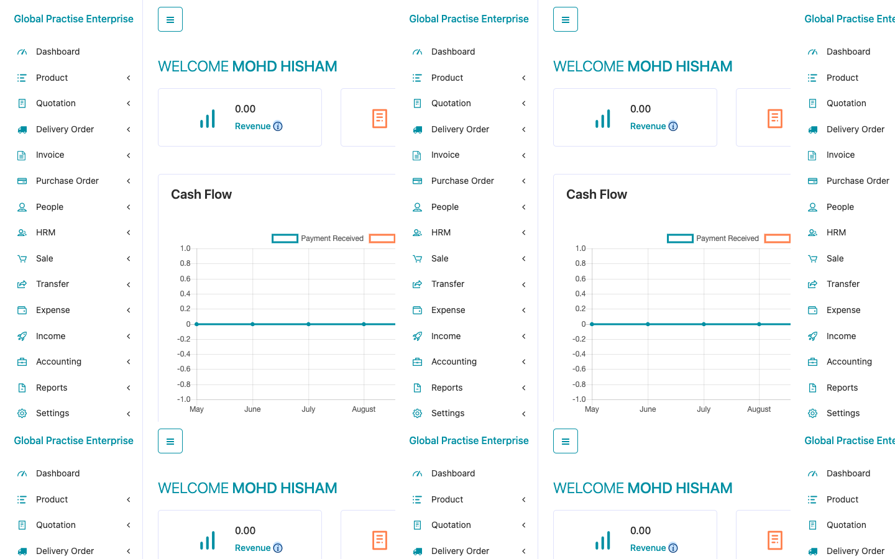
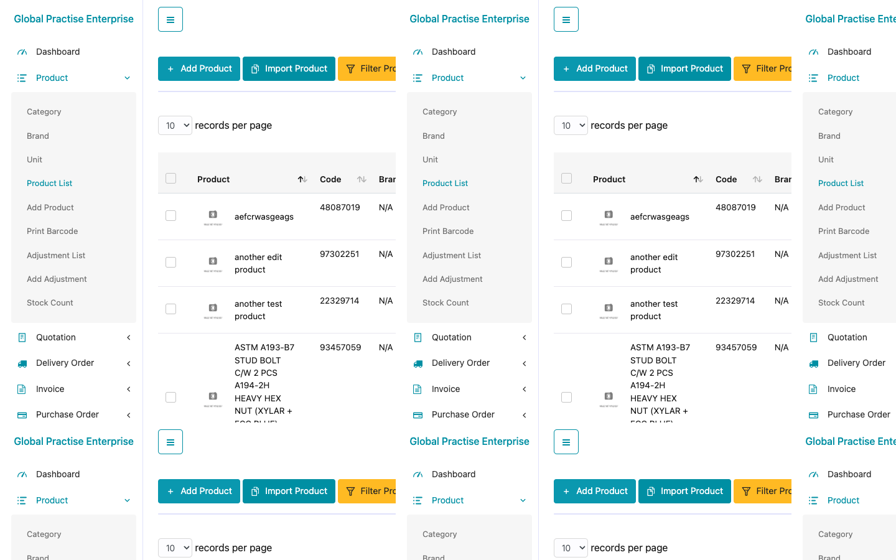
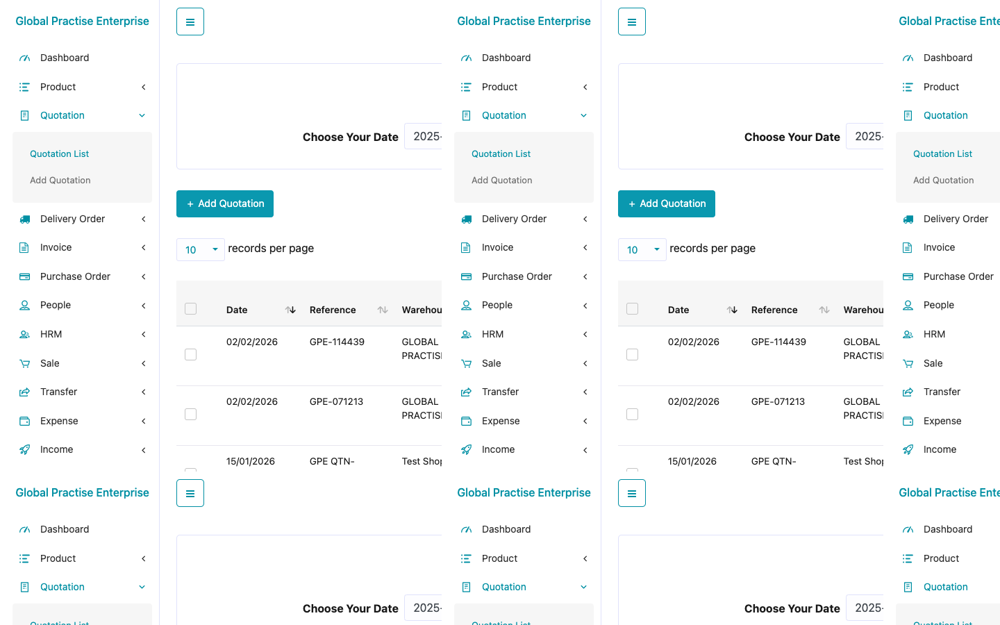
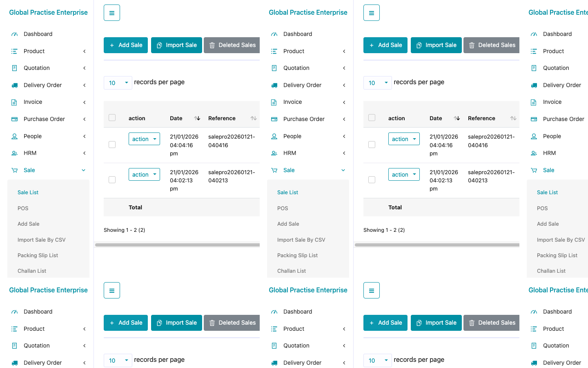
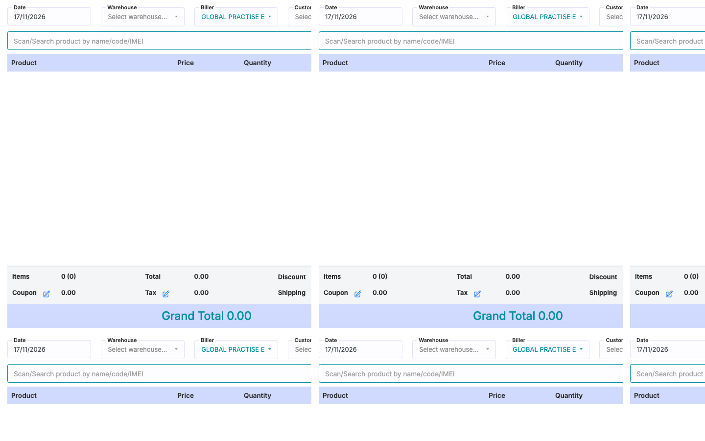

# GPE Procurement & POS System

Laravel **Point of Sale + procurement** platform for multi-warehouse retail and B2B operations — inventory, quotations, purchase orders, POS/sales, people, HRM, accounting, and reporting.

---

## What it is

A full **POS + procurement** admin panel covering the day-to-day ops loop:

- Manage **products, stock, purchases, sales** across warehouses
- Run **POS checkout**, quotations, invoices & delivery orders
- Track **customers, suppliers, dues, deposits & payments**
- Handle **expenses, income & accounting**
- Optional **HRM** (attendance, leave, payroll)
- Export / filter **reports** across sales, purchases, stock & people

---

## Screenshots

| Screen | Preview |
|--------|---------|
| Dashboard |  |
| Products |  |
| Purchases |  |
| Quotations |  |
| Sales |  |
| POS |  |
| Customers |  |
| Suppliers |  |

---

## Feature highlights

### 1) Dashboard & analytics
- KPI overview: sales, purchases, quotations, payments, invoices, delivery orders
- Best-selling products (yearly / monthly by qty & price)
- Recent sale, purchase, quotation, payment, invoice & delivery activity
- Warehouse + date-range dashboard filters
- Theme switch

### 2) Products & inventory
- Product list / add / edit (SKU, price, image, tax, variants, batches)
- Categories, brands, units
- Warehouse-wise stock & product history
- Stock adjustments (increase / decrease)
- Stock count
- Print barcode
- Product quantity / expiry alerts
- CSV-friendly catalog workflows

### 3) Quotations
- Quotation list & add quotation
- Convert / follow quotation → sale flow
- Warehouse & date filters
- Printable quotation documents

### 4) Delivery orders & invoices
- Delivery order list & create
- Invoice list & add invoice
- Document prefixes / printable docs

### 5) Purchase / procurement
- Purchase order list & create
- Import purchases by CSV
- Purchase returns
- Supplier + warehouse filters
- Payments against purchases
- Purchase due tracking

### 6) Sales & POS
- Full **POS** screen (warehouse, category/brand filters, product grid, cart, payments)
- Sale list & add sale
- Import sales by CSV
- Packing slip list
- Challan list
- Delivery list
- Gift cards & coupons
- Courier list
- Sale returns
- Multi payment methods (cash, card, cheque, gift card, etc.)

### 7) Stock transfers
- Transfer list & add transfer
- Import transfers by CSV
- Inter-warehouse stock movement

### 8) People
- Customer list (import CSV, deposits, loyalty points, clear due, ledger)
- Supplier list (import CSV, clear due, ledger, due report)
- User list
- Sale agents
- Billers
- Customer groups & discount plans

### 9) HRM
- Departments & designations
- Shifts
- Employees
- Attendance
- Holidays
- Overtime
- Leave types & leave requests
- Payroll

### 10) Expense & income
- Expense categories, list & add expense (receipt upload)
- Income categories, list & add income
- Warehouse / account linking

### 11) Accounting
- Account list & add account
- Money transfer between accounts
- Balance sheet
- Account statement

### 12) Reports
- Activity log
- Summary report
- Best seller
- Product report
- Daily / monthly sale
- Daily / monthly purchase
- Sale report & sale report chart
- Challan report
- Payment report
- Purchase report
- Customer / customer group / customer due report
- Supplier / supplier due report
- Warehouse report & warehouse stock chart
- Product expiry report
- Product quantity alert
- Daily sale objective report
- User report & biller report
- Cash register

### 13) Settings & access control
- Role & permissions (ACL)
- Warehouses
- Customer groups
- Currency & tax
- Receipt printers
- Invoice settings
- Barcode settings
- General / mail / HRM settings
- User profile
- Multi-language / translations
- SMS templates

### 14) Manufacturing (module)
- Recipes
- Productions & production cost tracking

---

## Tech stack

| Layer | Technology |
|-------|------------|
| Backend | **PHP**, **Laravel** |
| Auth / ACL | Session auth, roles & permissions |
| Architecture | Modular (`nwidart/laravel-modules`) |
| UI | Blade, Bootstrap, jQuery, DataTables |
| Database | **MySQL** |

---

## Local setup (high level)

```bash
composer install
cp .env.example .env
php artisan key:generate
# configure DB in .env
php artisan migrate --seed
php artisan serve
```

> Portfolio snapshot for case-study / interview review. Production credentials and client data are not included.
