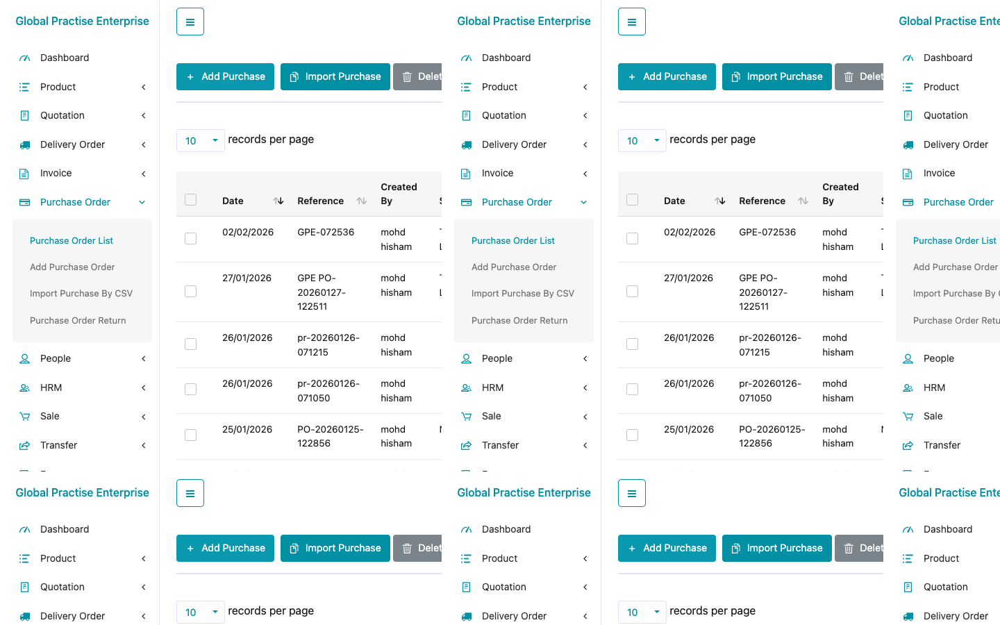
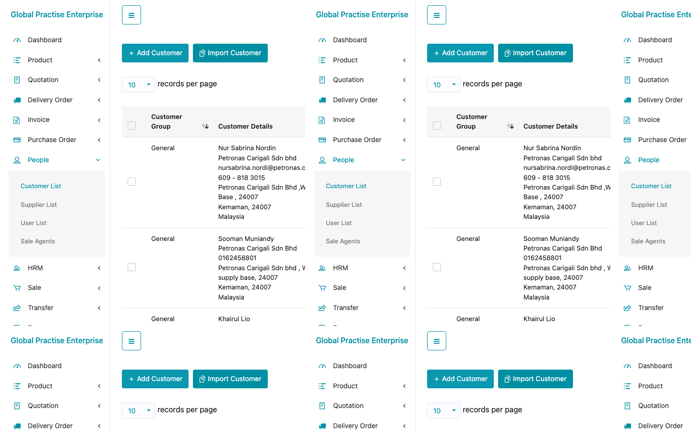
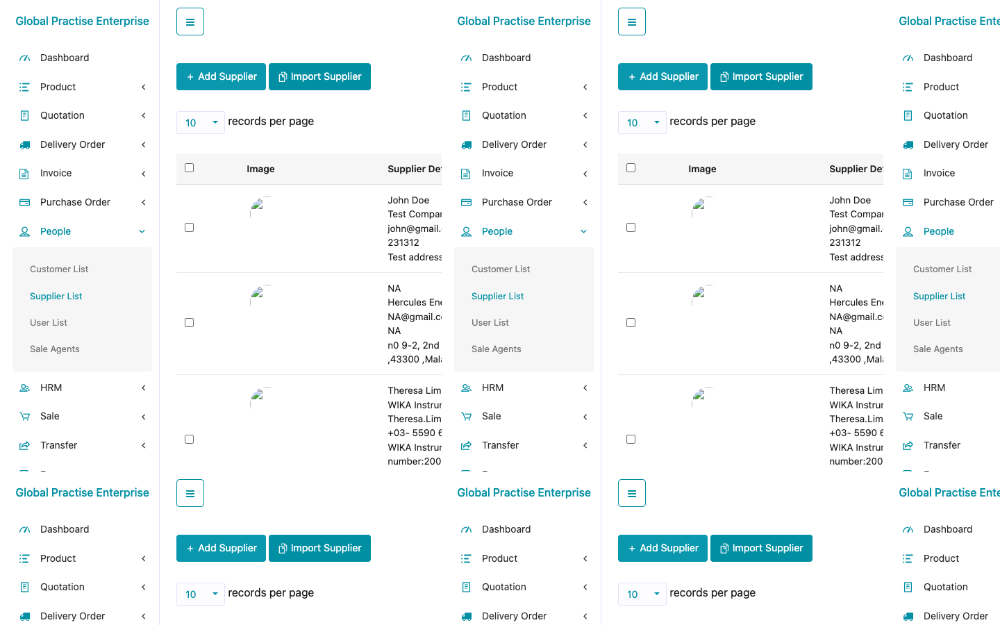

# GPE Procurement & POS System

Laravel **Point of Sale + procurement** platform for multi-warehouse retail and B2B ops — products, quotations, purchase orders, sales/POS, customers, suppliers, accounting, and reports.

> Built & customized by **Muhammad Usman** (Laravel / PHP) for **Global Practise Enterprise (GPE)**.

---

## What it is

A full **POS + procurement** admin panel:

- **POS checkout** with warehouse, barcode, categories & cart
- **Products / inventory** (SKU, stock, brands, categories, barcodes)
- **Purchase orders** & supplier workflow
- **Quotations → sales / invoices**
- **Customers & suppliers** with dues / deposits
- **Accounting** (accounts, transfers, balance sheet)
- **HRM** (attendance, leave, payroll) + role permissions
- Multi-language UI, receipts / packing slips / challans

---

## Screenshots

| Screen | Preview |
|--------|---------|
| Dashboard |  |
| Products |  |
| Purchases |  |
| Quotations |  |
| Sales |  |
| POS |  |
| Customers |  |
| Suppliers |  |

---

## Feature highlights

### POS & sales
- Fast POS screen (warehouse, product grid, cart, payments)
- Sale list, packing slips, challans, deliveries, returns
- Gift cards, coupons, couriers

### Procurement
- Purchase order list / create / CSV import
- Purchase returns & supplier dues
- Stock transfers & adjustments / stock count

### Catalog
- Products, categories, brands, units
- Barcode print & stock alerts

### People & HRM
- Customers, suppliers, users, sale agents
- Departments, designations, shifts, attendance, leave, payroll

### Finance & reports
- Expense / income, accounts, money transfer, balance sheet
- Daily/monthly sale & purchase, best seller, payment & due reports

---

## Tech stack

| Layer | Technology |
|-------|------------|
| Backend | **PHP**, **Laravel** |
| Auth / ACL | Session auth, roles & permissions |
| Architecture | Modular (`nwidart/laravel-modules`) |
| UI | Blade, Bootstrap, jQuery, DataTables |
| Database | **MySQL** |

---

## Local setup (high level)

```bash
composer install
cp .env.example .env
php artisan key:generate
# configure DB in .env
php artisan migrate --seed
php artisan serve
```

> Portfolio snapshot for case-study / interview review. Production credentials and client data are not included.

---

## Role

Customized and extended a Laravel POS/procurement stack for GPE — inventory, procurement flow, POS sales, people/HRM, and reporting for day-to-day operations.
